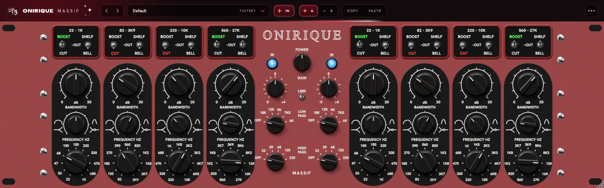

# Onirique Massif

Un égaliseur passif stéréo à lampes, deux canaux de quatre bandes, dans l'esprit
du grand égaliseur passif de mastering à façade de rack 3U : la même façade, les
mêmes réglages aux mêmes places, peinte en rouge là où l'original est violet.

- **le bas et le bas-médium (bandes 1 et 2)** : le réseau passif de l'original,
  tel quel. Des cloches qui vont de très larges à étroites et se resserrent quand
  on pousse, des coupes un peu plus étroites que les boosts, des étagères qui
  résonnent quand on ferme la bande passante (une bosse avant la fréquence, un
  creux juste après), et des bandes qui se chargent l'une l'autre : deux bandes
  poussées côte à côte donnent moins que leur somme. Derrière, les lampes, et le
  fer qui épaissit la basse quand elle est forte ;
- **le haut-médium et l'aigu (bandes 3 et 4)** : un hybride. Chaque bande est
  pour moitié ce même réseau passif, pour moitié une bande en classe A discrète,
  à la largeur stable quel que soit le gain et à l'étagère qui ne résonne jamais ;
  le sommet tombe là où le bouton le dit, la forme est entre les deux. Les aigus
  ne passent pas par les lampes, seulement par un étage discret très propre.

La façade est une photographie : la façade et chaque position de chaque pièce sont
modélisées en 3D et rendues par lancer de rayons (`tools/photo.cpp`), plaques
noires, fenêtres des commutateurs, leviers chromés, voyants bleus. Le plugin ne
fait qu'afficher ces images (`Resources/photo`) ; les mots BOOST (vert) et CUT
(rouge) des fenêtres et les voyants IN s'allument comme sur l'appareil.

VST3 (Windows, macOS) et Audio Unit (macOS). Mono ou stéréo. Traitement à
fréquence doublée : quelques échantillons de latence, annoncés à l'hôte.



---

## Les réglages

Par canal (gauche, droite) :

| Réglage | Ce qu'il fait |
|---|---|
| Gain (bande) | 0 à 20 dB, vers le haut ou le bas selon BOOST / OUT / CUT |
| Bandwidth | de très large à étroite ; en SHELF, la résonance de l'étagère |
| Frequency | onze positions : 22 Hz-1 kHz, 82 Hz-3,9 kHz, 220 Hz-10 kHz, 560 Hz-27 kHz |
| BOOST / OUT / CUT | le levier de la fenêtre ; BOOST s'allume en vert, CUT en rouge |
| SHELF / BELL | étagère (grave pour les bandes 1-2, aiguë pour 3-4) ou cloche |
| IN | le voyant bleu : en service ; éteint, bandes et filtres à plat, les lampes restent |
| Gain | -6 à +4 dB en sortie |
| Low Pass | OFF, 18, 12, 9, 7,5, 6 kHz ; 24 dB par octave |
| High Pass | OFF, 22, 39, 68, 120, 220 Hz ; 18 dB par octave |

Au milieu : **LINK** (levier en haut, tourner un réglage tourne son jumeau de
l'autre côté ; en l'enclenchant, la droite prend les réglages de la gauche) et
**POWER** (éteint, le signal tel qu'il est entré).

Survoler ou tourner un réglage affiche sa valeur juste à côté de lui ; un
double-clic remet un bouton à sa valeur de départ. Chaque levier d'une fenêtre
prend toute sa moitié de fenêtre, mots compris : un clic sur BOOST, CUT, SHELF ou
BELL y envoie le levier (un clic sur le mot déjà allumé remet la bande en OUT) ;
on peut aussi le glisser vers le haut ou le bas, ou tourner la molette dessus.

Les courbes ont été placées par raisonnement à partir de ce que l'on sait de
l'original (spécifications publiées, comportement d'un réseau passif), pas mesurées
sur un appareil ; la quantité de couleur des lampes et du fer reste à régler à
l'oreille.

---

## Construire

JUCE 9.0.3 est cherché dans `JUCE/`, puis dans `../PitchBox/JUCE` : les plugins
de la gamme partagent la même copie.

```bash
cmake -B build -A x64
cmake --build build --config Release --parallel
ctest --test-dir build -C Release --output-on-failure
```

Le plugin sort dans `build/OniriqueMassif_artefacts/Release/VST3/OniriqueMassif.vst3`.

Les photographies de la façade, après un changement de modèle, de lumière ou de
disposition (`Source/ui/Layout.h`, partagé avec l'interface) ; quelques minutes
sur 28 cœurs, `0.1` au lieu de `1.3` pour un aperçu rapide :

```bash
cmake --build build --config Release --target massif_photo
build/massif_photo_artefacts/Release/massif_photo Resources/photo 1.3
build/massif_photo_artefacts/Release/massif_photo apercu 0.1 front,knob,small,centre,toggle,lever,preview
```

Une capture de l'interface, sans hôte, et le plugin entier mis à l'épreuve :

```bash
cmake --build build --config Release --target massif_snapshot
build/Release/massif_snapshot capture.png 1.5
build/Release/massif_snapshot --selftest
build/Release/massif_snapshot --switches
```

Sur GitHub, chaque push construit Windows et macOS ; les plugins sont déposés sur
les branches `ci-build-Windows` et `ci-build-macOS`, les journaux sur `ci-logs-*`.

`License/` est copié tel quel de `plugin-license/` du dépôt ONIRIQUE CENTRAL, et
ne se modifie que là-bas. Identifiant de la licence : `onirique-massif`.
